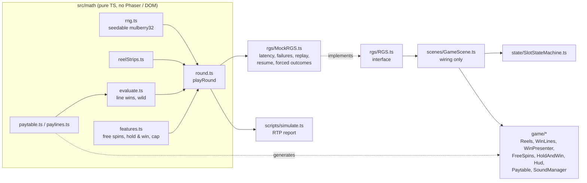
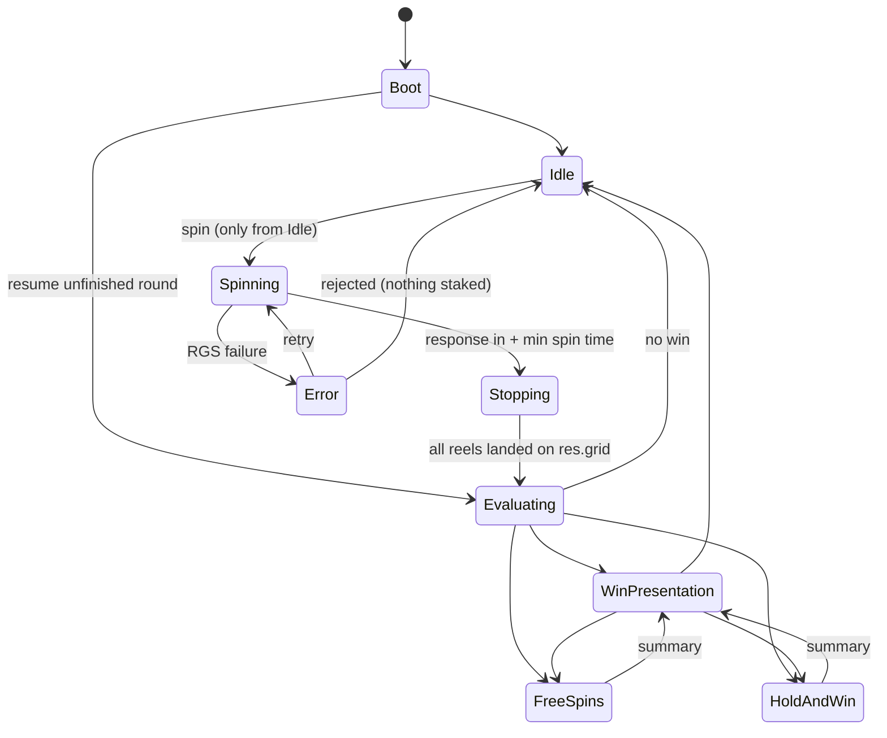

# Parol Nights — Phaser 3 Slot Sample

A 5x3, 40-line HTML5 slot built the way a regulated-market studio builds a client: the client only renders a result decided by a (mock) remote game server (RGS). It has a strict state machine, **Free Spins with a growing multiplier**, **Hold & Win** respins with jackpots, and certification-style tooling: seeded replay, forced outcomes (dev only) and an RTP simulation.

Phaser 3.90 · TypeScript (strict) · Vite 8 · desktop and mobile (portrait and landscape, live rotation).

- **Live demo:** not deployed yet (see [SKIPPED.md](SKIPPED.md))
- **Gameplay video:** not recorded yet (see [SKIPPED.md](SKIPPED.md))

## Run it

```bash
npm install
npm run dev        # dev server, debug panel bottom-left
npm run build      # production bundle in dist/ (debug code stripped)
npm run check      # assert-based self-checks: math, strips, features, cap, MockRGS, state machine
npm run lint       # ESLint; also bans Phaser / DOM imports in src/math and scripts
npm run simulate -- --spins 1000000 --seed 42
```

Controls: **Space** or the spin button spins. During a spin it stops the reels quickly. During a win or feature, tap anywhere (or press Space) to skip.

## Architecture



| Layer | Owns | Never does |
|---|---|---|
| `src/math/` | All outcome logic. Deterministic for a given seed, so Node can run it. | Import Phaser or touch the DOM |
| `src/rgs/` | The contract the client talks to. `MockRGS` wraps `math/` and adds latency, failures, persistence and replay. | Get imported by `game/` modules |
| `src/state/` | Which transition is legal next. Illegal transitions throw; dev logs every transition. | Render anything |
| `src/scenes/GameScene.ts` | Wiring: creates modules, calls the RGS, feeds the response to the state machine and the presenters. | Layout math, outcome logic |
| `src/game/` | One concern per module (reels, lines, win count-up, features, HUD, modals, sound). Pooled objects; every presentation can be skipped. | Call the RGS or decide outcomes |

The client never computes a win. Every amount on screen comes from `SpinResponse`: line wins, feature steps, coin values, totals. Dev builds warn if the displayed total differs from `totalWin`. Money is integer minor units everywhere and is formatted only at render time (`utils/format.ts`). The paytable modal is generated from `math/paytable.ts` and `math/paylines.ts`.

`AGENTS.md` has the full conventions. `IMPLEMENTATION_STATUS.md` records decisions and deviations from the brief.

## State machine



- `Spinning` starts the visual spin immediately and waits for the RGS in parallel. Reels stop once both the minimum spin time has passed and the response is in.
- Reels land on `stops` / `grid` from the response. A dev assertion checks that the landed window equals `res.grid`.
- On an RGS error a retry modal appears, and the reels never spin forever. Retry is always safe: `spin()` returns the already-committed round if there is one.
- Refreshing mid-round resumes the unfinished round. Inside a feature, playback continues from the last completed free spin or respin (`utils/progress.ts`).

## RGS contract

The client sends a bet and receives the **whole round**: the base spin plus every feature step. It plays the round back and never re-evaluates it.

```ts
interface RGS {
  init(): Promise<InitResponse>;                     // session, balance, bet levels, display strips, unfinished round
  spin(req: SpinRequest): Promise<SpinResponse>;     // returns the unfinished round instead, if one exists
  complete(roundId: string): Promise<void>;          // client finished presenting
}

interface SpinRequest { sessionId: string; bet: number }          // bet = total bet, minor units

interface SpinResponse {
  roundId: string;
  bet: number;                       // stake of this round (a resumed round may differ from the current bet)
  balance: number;                   // after the round
  stops: number[];                   // reel stop positions
  grid: SymbolId[][];                // [reel][row]
  lineWins: { line: number; symbol: SymbolId; count: number; win: number }[];
  baseWin: number;
  feature?: FreeSpinsRound | HoldAndWinRound;
  totalWin: number;                  // includes the feature, capped at 5000x bet
  capped: boolean;
}

interface FreeSpinsRound {
  type: 'freeSpins'; awarded: number; totalWin: number; capped: boolean;
  spins: { stops: number[]; grid: SymbolId[][]; lineWins: LineWin[]; multiplier: number;
           win: number; retrigger: number; spinsLeft: number }[];
}

interface HoldAndWinRound {
  type: 'holdAndWin'; awarded: number; grand: number; totalWin: number; capped: boolean;
  initial: Coin[];                                   // Coin = { pos: reel*3+row, value, jackpot? }
  respins: { coins: Coin[]; respinsLeft: number }[];
}
```

Errors are typed as `RGSError` with codes `network | session | invalidBet | insufficientFunds`. Only `network` retries.

`MockRGS` behaviour:
- **Latency and failures** are injectable. Half the failures happen before commit (nothing debited), half after commit (the response is lost; retry returns the same round).
- **Seeded replay:** round seed = `deriveSeed(sessionSeed, nonce)`, and `roundId` encodes it. `replay(roundId, bet, balanceBefore)` rebuilds a bit-identical response.
- **Persistence:** balance, seed, nonce and the unfinished round live in `localStorage['parol-nights-rgs']`.
- **Rename migration:** startup copies the legacy session, feature progress and mute values unchanged into `parol-nights-rgs`, `parol-nights-progress` and `parol-nights-muted`. Each old key is removed only after its copy succeeds. Existing destination keys are left untouched; storage errors are caught. Debug reset clears both current and legacy session/progress keys so a retained legacy value cannot restore a reset session.
- **Forced outcomes (dev only):** free spins, retrigger, hold & win, grand, big / mega win, cap. The mock scans seeds until a real round matches, so forced rounds replay too.

## Game rules (summary)

- 5 reels x 3 rows, 40 fixed lines, left to right, 3+ from reel 1. Line bet = total bet / 40.
- WILD lands on reels 2–4 only and substitutes for paying symbols only.
- **Free Spins:** 3/4/5 SCATTER award 10/12/15 spins. The multiplier starts at x1 and grows by +1 after each winning spin, up to x15. 3+ SCATTER retrigger +5. Free spins use their own strips.
- **Hold & Win:** 6+ COIN in the base game. Coins lock, 3 respins, and any new coin resets the respins to 3. Jackpot coins: Mini 20x, Minor 50x, Major 200x. Filling all 15 cells adds the Grand, 1000x.
- **Max win 5000x total bet:** the round ends the moment the cap is reached, and the UI shows "MAX WIN REACHED".
- Win tiers: big 15x, mega 50x, epic 100x. Turbo shortens reel timings but never skips results.

## Math and simulation

```bash
npm run simulate -- --spins 1000000 --seed 42 [--bet 400] [--out docs/simulation-report.txt]
```

Same seed, same output (timing goes to stderr). Latest committed report, [docs/simulation-report.txt](docs/simulation-report.txt):

| Metric | Value |
|---|---|
| RTP (1M spins, seed 42) | **95.18%** (base 61.54 / free spins 18.85 / hold & win 14.79), target 95–96%, acceptance 94.5–96.5% |
| Hit frequency | 34.58% (1 in 2.9) |
| Free spins | 1 in 189, avg 35.6x |
| Hold & Win | 1 in 251, avg 37.1x, Grand 1 in 66,667 |
| Max win seen | 1129x (cap never reached) |
| Volatility (SD) | 5.99x bet |

Re-running seed 42 on 2026-10-13 reproduced the committed report byte for byte.

## Debug tools (dev build only)

The debug panel (bottom-left) can force the next round, set the session seed, set latency and failure rate, reset the session, and show FPS. Console hooks: `__rgs` (MockRGS) and `__game` (Phaser.Game). Everything is behind `import.meta.env.DEV`, so the production bundle has none of it. Verify with:

```bash
grep -o "forcePicker\|__rgs\|__game\|Reset session\|console.error\|force=" dist/assets/*.js   # expect no output
```

## Bundle size

Production build, 2026-10-13 (`npm run build`):

| File | Raw | Gzip |
|---|---|---|
| `assets/index-*.js` (game + Phaser 3.90) | 1,276.9 KB | 345.0 KB |
| `index.html` | 0.7 KB | 0.5 KB |
| 3 Latin WOFF2 fonts | 53.8 KB | 53.9 KB |
| Theme WebPs (including 71.1 KB optional food icons, not requested at runtime) | 666.2 KB | 664.8 KB |
| Font license notices | 9.0 KB | 4.0 KB |
| 6 MP3 SFX (deferred; 2 more under 4 KB are inlined in the JS) | 69.2 KB | (already compressed) |
| **Total `dist/`** | **2,075.8 KB** | **1,109.0 KB** |

Measured after art integration with Node `zlib.gzipSync` (decimal KB; total gzip is the sum
of individually compressed files). Critical art is 493.7 KB landscape / 489.6 KB portrait;
the opposite background and audio load deferred. Existing startup fonts are separate.
See [art integration report](docs/art-integration.md) for mapping, resize logs, preserved
placeholders, original-asset sizes, screenshots/evidence paths and verification limitations.
Title: Cinzel Decorative 700. UI/numbers: Baloo 2 400/700. Both SIL OFL 1.1;
local Latin WOFF2 only. Font details, license links, fallback behavior and
validation evidence: [docs/typography.md](docs/typography.md).

Almost all of the JS is Phaser. The approved title ornament ships as a WebP;
other symbol/UI art is generated at boot. Fonts load locally with a 1.5-second
startup timeout and late-load refresh. Audio loads after the first screen; spin
shows "LOADING n%" until it is ready.

## Performance

Art integration recheck (412 x 915, DPR 2, 4x CPU throttle): actual Phaser rendered-frame
counts over four seconds averaged **115.2 FPS idle / 91.0 FPS big win**. Big-win p95 was
15.7 ms, with one 28.1 ms frame. Neither average fell below 55; the slowest individual
frame did. This desktop-GPU check is not physical Android/iOS validation. The longer
prototype measurements below predate the finished art.

Measured 2026-10-13 in headless Chrome, with puppeteer driving the dev build. Settings: mobile viewport 412x915 / 915x412 at DPR 2.625 (canvas 1081x2402), **4x CPU throttle** (CDP `Emulation.setCPUThrottlingRate`). Each run was 75 s of auto-play with forced big win, hold & win, free spins and mega win. Frame times came from a `requestAnimationFrame` probe. The display ran at 144 Hz, so an unthrottled baseline is about 144 FPS.

| Orientation | Avg FPS | Worst 1 s window | 5th-percentile 1 s window | p95 frame | Frames > 33 ms |
|---|---|---|---|---|---|
| Portrait | 98.1 | 65.1 | 71.0 | 14.0 ms | 4 of 7376 |
| Landscape | 109.8 | 67.0 | 76.9 | 14.0 ms | 7 of 8239 |

Average frame cost per state at 4x throttle: 7–12 ms in every state, including the big win overlay with coin rain and rays.

The first measurement found big wins at about 41 FPS. The cause was the winning-cell frames: a single `Graphics` object with up to 70 rounded strokes, which Phaser re-tessellates every frame. It cost about 36 ms per frame at 4x throttle. The frames are now 15 pooled tinted images, and the same scene costs 10.8 ms instead of 47.7 ms.

Caveats: the GPU was a desktop RTX 3060, so the throttle only simulates a slow CPU. One portrait run showed a single 1.6 s frame that did not happen again in two later runs (likely a host hiccup). A check on a real mid-range Android device is still worth doing.

## Ship checklist status

See the Ship Checklist in [AGENTS.md](AGENTS.md). Everything is ticked except the live demo link and the gameplay video, which [SKIPPED.md](SKIPPED.md) lists.

## Project layout

```
src/main.ts            DOM gate, single Phaser.Game, responsive resize (rAF + retries + per-frame visualViewport poll)
src/constants.ts       reference sizes, THEME, layouts, DEPTH map
src/gameConfig.ts      client tunables: bets, balance, timings (+ turbo), win tiers, presentation timings
src/math/              paylines, paytable, strips, rng, evaluate, features, round (pure TS)
src/rgs/               types, RGS interface, MockRGS, force (dev only)
src/state/             SlotStateMachine
src/scenes/            BootScene (critical art, fallback textures), GameScene (wiring, deferred loading)
src/theme/             Parol Nights texture keys and asset URLs
src/game/              Reels, Symbol, WinLines, WinPresenter, FeatureOverlay, FreeSpins, HoldAndWin,
                       Hud, Paytable, ErrorModal, SoundManager, fx, DebugPanel (dev only)
src/utils/             responsive (sx/sy/sd), format, timeline (skippable steps), anticipation, progress, fitText
scripts/               simulate.ts, check.ts, spin.ts (inspect one seeded round)
docs/                  simulation-report.txt
Assets/audio/          placeholder SFX + SOUND_MAP.txt
```
